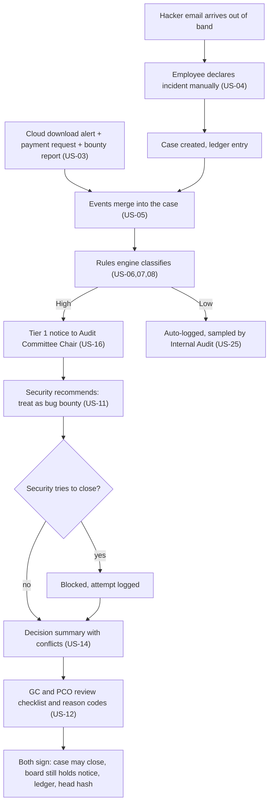
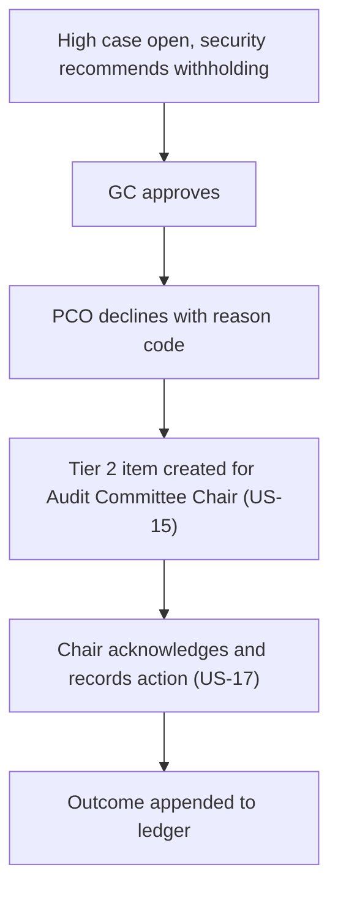
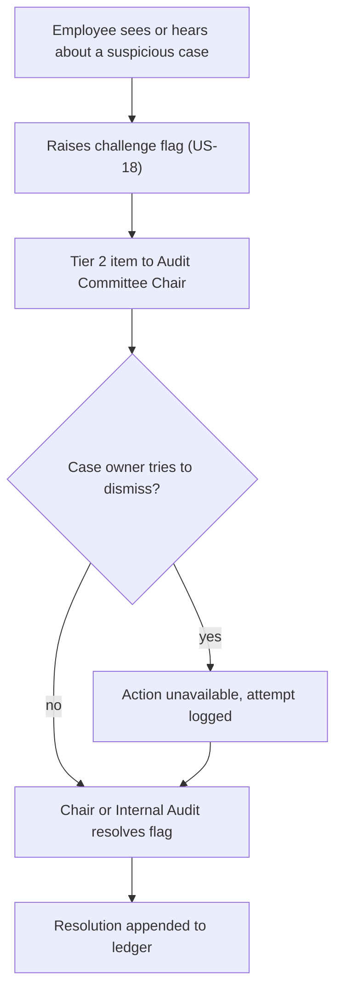
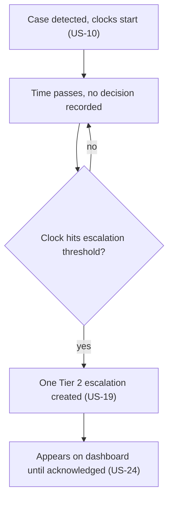
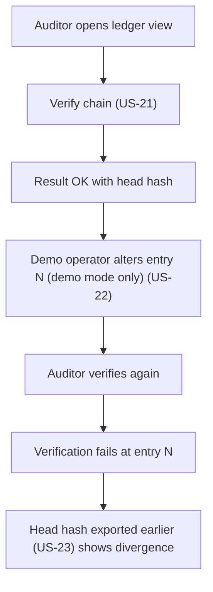

# Uber Prototype — Starter Spec: Roles, User Stories, Acceptance Criteria, Flows, Screens (DRAFT v0.1, 26 Oct 2026)

**How to use this.** This is a *starter* drafted by Claude from the MVP list, failure matrix and replay scenario in `00-CONTEXT.md`. The team must edit it in its own words, delete what you will not build, and decide the open questions in §6. When the repo exists this file splits into `docs/spec/00-roles.md`, `01-stories.md`, `02-flows.md`, `03-screens.md`; each story becomes a GitHub issue labelled `story` + its epic, and each acceptance criterion becomes a test named `US-xx: <criterion>`.

Priority = MoSCoW. **Must** = needed for the replay scenario or the failure matrix. Anything not Must is cut first if time runs out (freeze Fri 6 Nov).
"Traces" = failure-matrix row (F1–F12) and demo scenario (A–F), both listed in `00-CONTEXT.md` §6–§7.

## 1. Roles (from MVP item 1 in `00-CONTEXT.md`)

| Code | Role | Can | Cannot |
|---|---|---|---|
| SA | Security analyst | Investigate, contain, add evidence, **recommend** | Close, downgrade, approve |
| CISO | Chief Information Security Officer | See all case data, recommend | Approve, close, downgrade, edit board notices (holds no key) |
| GC | General Counsel | Approver #1, owns the rule pack | Be sole approver |
| PCO | Privacy/Compliance Officer | Approver #2, can go to the board | Be sole approver |
| IA | Internal Audit | Read everything, sample auto-closed Low cases | Change any case |
| ACC | Audit Committee Chair | Receive Tier 1, act on Tier 2 | Edit cases |
| EMP | Ordinary employee | Declare an incident, raise a challenge flag | See case detail |
| DEMO | Demo operator (demo mode only) | Fire simulated events, reset/seed, tamper | Exists only when `DEMO_MODE=true` |

Rule for every story: **deny by default, enforced on the server**, not just hidden in the UI.

## 2. Stories and acceptance criteria

### E1 Access and demo control
**US-01 (Must)** As any user, I want to sign in as a demo role so that I only see what that role may see. Traces: F1, F2.
- Given I am signed in as EMP, when I open a case URL directly, then the server returns "not permitted" and nothing about the case is shown.
- Given I am signed in as SA, when I call the approve action directly, then it is refused and the refusal is written to the ledger.

**US-02 (Must)** As the demo operator, I want one action that resets and seeds the demo so that the scenario can be re-run. 
- Given any state, when I run reset, then cases are cleared, seed users and rule pack v1 exist, the ledger starts with a genesis entry, and `verify` returns OK.

### E2 Intake and correlation
**US-03 (Must)** As the demo operator, I want to fire simulated events (bounty report, payment request, cloud download alert) so that the replay can be shown. Traces: F3, F5, F12.
- Given demo mode is on, when I fire "bounty report: $100k, pseudonymous payee", then an intake event is stored and appears in the ledger.
- Given demo mode is off, then the simulator is unreachable.

**US-04 (Must)** As any employee, I want to declare an incident manually so that an out-of-band event opens a case. Traces: F11, scenario A.
- Given I am EMP, when I submit a declaration with a short description, then a case is created with source "manual", the declarant is recorded, and the declarant cannot read the case afterwards.

**US-05 (Must)** As a security analyst, I want events about the same incident merged into one case so that I see the full picture. Traces: F3, F12.
- Given a download alert and a payment request carry the same case reference (or match the matching rule), when both arrive, then they attach to one case and the case shows both.
- Given events with different references, then two separate cases exist.

### E3 Rules and clocks
**US-06 (Must)** As a security analyst, I want the system to classify a case High or Low using the active rule pack so that classification does not depend on one person. Traces: F1, scenario A, C.
- Given a case with any High trigger, when classification runs, then the case is High and the matching rule IDs are listed.
- Given a low-risk event only (blocked login), then the case is Low and auto-logged.

**US-07 (Must)** As General Counsel, I want a payment linked to an incident to be High regardless of its label so that "bug bounty" cannot disguise extortion. Traces: F3.
- Given a payment tagged "bug bounty" linked to an incident case, when classification runs, then rule R-PAY-LINKED fires and the case is High; the label does not change the result.

**US-08 (Must)** As a compliance officer, I want pseudonymous payees, payouts above the programme cap, and a pending regulator inquiry to raise the tier so that known 2016 warning signs are caught. Traces: F4, F5, F7.
- Given payee_verified = false, then R-PAYEE fires. Given amount > programme max, then R-CAP fires. Given regulator_inquiry_open = true, then R-REGULATOR fires.

**US-09 (Should)** As General Counsel, I want the rule pack versioned and owned by Legal so that changes are traceable. 
- Given I publish rule pack v2, then a ledger entry records the version, my identity and a diff; SA/CISO cannot publish.

**US-10 (Must)** As a case reader, I want to see elapsed time since detection and the internal and illustrative regime clocks so that deadlines are visible. Traces: F9, scenario F.
- Given a case detected at T, then the case shows days/hours since T, the internal SLA state (e.g. classification due), and each regime clock from the rule pack.

### E4 Decision gate
**US-11 (Must)** As a security analyst, I want to record a recommendation but not close or downgrade a High case so that security cannot decide alone. Traces: F1, scenario A.
- Given a High case, when SA or CISO presses close or downgrade, then it is blocked, a message names the missing approvals, and the attempt is in the ledger.

**US-12 (Must)** As GC and PCO, I want to approve or decline withholding disclosure with a conflict checklist and reason code so that each decision is accountable. Traces: F2, scenario A, B.
- Given both approvals recorded, then the case may close; each approval stores approver, time, reason code and checklist answers.
- Given only one approval, then the case stays open.

**US-13 (Must)** As the organisation, I want approvers from the security reporting line rejected so that the approvers are independent. Traces: F1.
- Given a user whose reporting line includes the CISO tries to approve, then the approval is refused with reason "not independent" and logged.
- Given the same person tries to give both approvals, then the second is refused.

**US-14 (Must)** As an approver, I want a one-page decision summary per case with conflicts highlighted so that I can decide quickly. Traces: F3, F12.
- Given security recommends "no data taken" and the telemetry shows downloads, then the summary shows a "recommendation conflicts with evidence" banner listing both.
- The summary shows what happened, data involved, regimes with time left, security's recommendation, open flags.

**US-15 (Must)** As the Audit Committee Chair, I want disagreement between approvers to escalate to me so that stalemate does not stay hidden. Traces: F8, scenario B.
- Given one approver declines, then a Tier 2 item is created for ACC within the same action and appears in ACC's inbox.

### E5 Board channel
**US-16 (Must)** As the Audit Committee Chair, I want an automatic read-only notice when a High case opens so that the board hears at once. Traces: F8, scenario A.
- Given a case becomes High, then a Tier 1 notice is created automatically; its text is generated from rule fields and cannot be edited or deleted by SA, CISO, GC or PCO; it is in the ledger.

**US-17 (Must)** As the Audit Committee Chair, I want to acknowledge and act on Tier 2 items so that escalations are closed. Traces: F8.
- Given a Tier 2 item, when I acknowledge with an action note, then it is marked handled in the ledger; unacknowledged items stay on my dashboard.

**US-18 (Must)** As any employee, I want to raise a challenge flag the case owner cannot dismiss so that doubts get heard. Traces: F6, scenario E.
- Given an open case, when EMP raises a flag, then a Tier 2 item is created; the case owner's dismiss action is unavailable; only ACC or IA can resolve it.

**US-19 (Should)** As the organisation, I want an automatic escalation when a legal clock is nearly out and no decision exists so that deadlines are not missed. Traces: F9, scenario F.
- Given a clock reaches its escalation threshold with no decision, then a Tier 2 item is created exactly once.

### E6 Evidence ledger
**US-20 (Must)** As an auditor, I want every intake, classification, recommendation, approval, refusal, flag and notice appended to a tamper-evident ledger so that history is provable. Traces: F10.
- Given any such event, then one ledger row is appended with sequence, previous hash, timestamp, actor, event type, payload hash; the hash is SHA-256 over canonical JSON.
- Given two events at the same moment, then the chain does not fork.

**US-21 (Must)** As an auditor, I want a Verify action so that I can check integrity. Traces: F10, scenario D.
- Given an untouched ledger, then verify reports OK with the entry count and head hash.

**US-22 (Must)** As the demo operator, I want a clearly labelled tamper button (demo mode only) so that detection can be shown. Traces: F10, scenario D.
- Given demo mode, when I alter entry N directly, then verify fails and names entry N. Given demo mode off, the button does not exist and the app DB user cannot update or delete ledger rows.

**US-23 (Should)** As the board, I want the head hash exported outside the application so that a database administrator cannot silently rebuild history. 
- Given a day boundary or a manual export, then the head hash and entry count are written to an external destination (simulated auditor inbox) and shown on the dashboard.

### E7 Dashboard and audit
**US-24 (Must)** As the Audit Committee Chair, I want a dashboard of open cases, Tier 1/2 items, clocks and "days from detection to board" so that I see control performance. Traces: F9, scenario A.
- Given the replay finished, then the dashboard shows time from detection to board notice and the contrast with Uber's 371 days.

**US-25 (Could)** As Internal Audit, I want a random sample of auto-closed Low cases so that Low is checked. 
- Given N Low cases, when I run sample, then k are listed with their ledger trail; marking reviewed is logged.

**US-26 (Could)** As a regulator/auditor-facing role, I want to export a case's evidence pack (JSON/PDF) so that I can hand it over.

**US-27 (Could)** As the organisation, I want a control self-test that runs a synthetic incident and reports time-to-board.

## 3. Traceability check (stories cover the failure matrix)
F1→US-11,13 · F2→US-12 · F3→US-07,14 · F4→US-08 · F5→US-08 · F6→US-18 · F7→US-08 · F8→US-15,16,17 · F9→US-10,19,24 · F10→US-20–23 · F11→US-04 · F12→US-03,05.
Scenarios: A→US-04,06,11,12,16 · B→US-15 · C→US-06 · D→US-21,22 · E→US-18 · F→US-19.

## 4. User flows (Mermaid; GitHub renders these)

### Flow 1 — Uber replay (scenario A)

### Flow 2 — One approver declines (scenario B)

### Flow 3 — Employee challenge flag (scenario E)

### Flow 4 — Deadline escalation (scenario F)

### Flow 5 — Tamper and verify (scenario D)

## 5. Screens for the Figma low-fi wireframes (about 8; grayscale boxes only)

| # | Screen | Roles | Main elements | Stories |
|---|---|---|---|---|
| S1 | Sign-in / role switch | all | Role picker, "Demonstration — synthetic data" banner | US-01 |
| S2 | Demo control panel | DEMO | Fire event buttons, reset/seed, tamper toggle, mode indicator | US-02,03,22 |
| S3 | Report an incident | EMP | Short form, confirmation page (no case view afterwards), challenge-flag entry | US-04,18 |
| S4 | Case list | SA, CISO, GC, PCO, IA | Filter by tier/status, clock chips, Tier badges, flag icon | US-05,06,10 |
| S5 | Case detail + decision summary | SA, CISO, GC, PCO, IA | Timeline of events, triggered rules, clocks, security recommendation, conflict banner, locked "Close" with reasons | US-11,14 |
| S6 | Approval dialog | GC, PCO | Conflict checklist, reason code, approve/decline, independence message | US-12,13 |
| S7 | Board dashboard + notices | ACC | KPI "days to board vs 371", Tier 1 feed, Tier 2 inbox with acknowledge, open flags, head-hash status | US-15–19,24 |
| S8 | Ledger view | IA, ACC, DEMO | Entry table (seq, time, actor, event, hash), Verify button/result, tamper button (demo only) | US-20–23 |

Wireframing rules: grayscale, real labels (not lorem ipsum), show the empty, blocked and error states for S5, S6 and S8, mark which elements are role-specific, name frames `S5-case-detail` etc. so developers can cite them in PRs.

## 6. Open questions the team must decide (affects code, so decide before P2)
1. Internal SLAs: classification due within how many hours, decision within how many days? (Pick numbers, label them illustrative.)
2. Regime clocks to include in rule pack v1 (SEC Item 1.05 from materiality determination, GDPR Art. 33 from awareness, PDPA): wording must be checked before it appears in the report.
3. Reporting-line check: model as a `reports_to` field on seed users, or a `team` field? (Simpler: `team`.)
4. What does a Tier 1 notice contain? Suggested: case ID, source, triggered rule IDs, data categories, clocks, "no action required, read-only".
5. Is "withhold disclosure" the only decision, or also "notify regulator now"? (Suggested: three outcomes: notify, notify later with date, withhold, each needing both approvals.)
6. Does Internal Audit sampling (US-25) make the cut? Decide by 3 Nov.
7. Which three stories do you want in the demo video's five minutes? (Suggested: US-07/11, US-12/15, US-22.)

## 7. Definition of done (per story)
1. Acceptance criteria exist as automated tests (unit for rules/ledger/gate; Playwright for flows).
2. Server-side authorisation tested for at least one forbidden role.
3. Ledger entry exists for every state change the story causes.
4. PR reviewed by a teammate who is not the author; reviewer ticked the security checklist if a trigger path was touched.
5. Screenshot added to `docs/evidence/` for the report.
